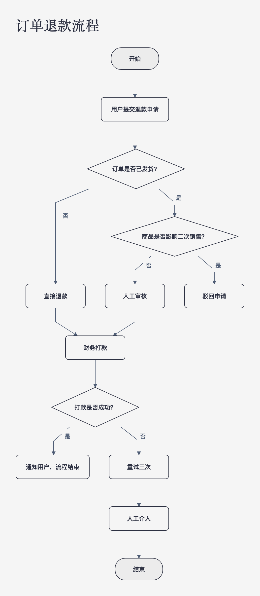
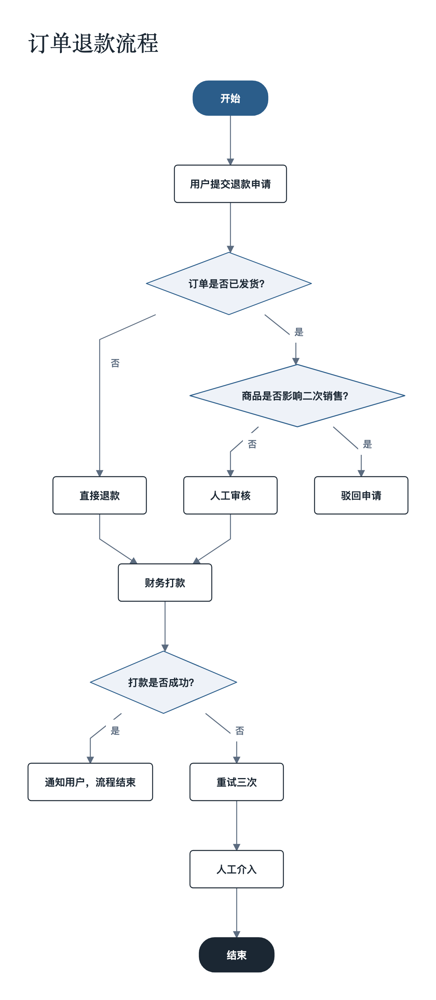
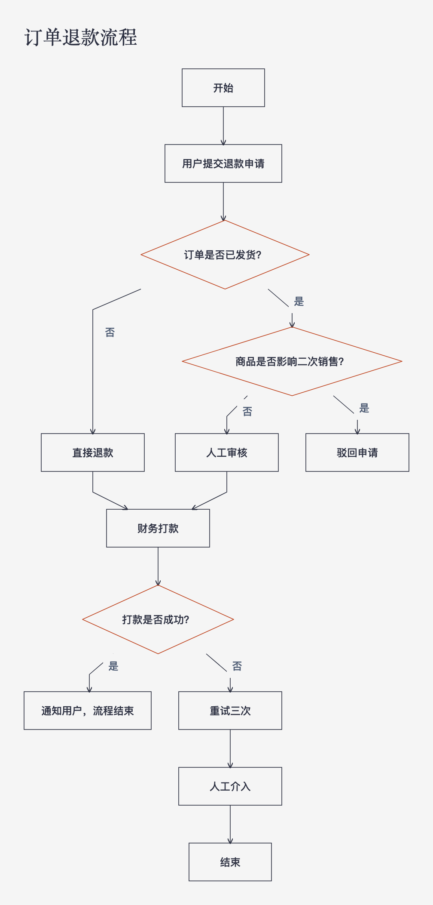
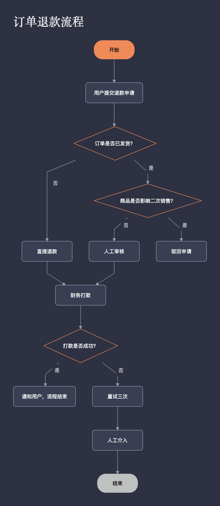
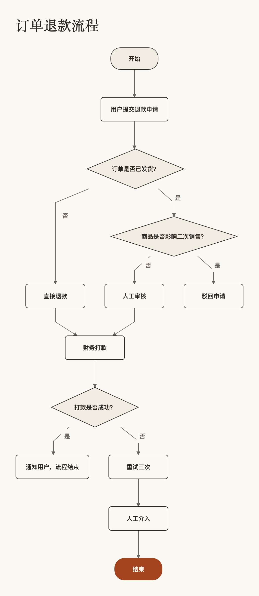

# 流程图精灵

Markdown 写流程，出一张版式稳定的流程图。导出 SVG，或导出可继续编辑的 Visio（.vsdx）。

## 现在能做什么

```bash
cd packages/core

# 先看效果
node bin/flowchart.js 你的流程.md -o 流程.svg
node bin/flowchart.js 你的流程.md -o 流程.vsdx
node bin/flowchart.js 你的流程.md -o 流程.svg -t business
node bin/flowchart.js 你的流程.md -o 流程.svg -t minimal --palette dark
node bin/flowchart.js --list                 # 看所有模板与配色
```

`-o` 按扩展名决定格式：`.svg` 或 `.vsdx`。诊断信息打 stderr，有 error 就不生成文件。

## 模板

五套模板，`-t/--template` 选；四套配色，`-p/--palette` 选。**模板和配色正交** —— 模板决定形状与排版，配色只管颜色，所以 `-t business -p dark` 是合法的：商务骨架配深色。

| 模板 | 配色 | 长什么样 |
|---|---|---|
| `default` | light | 冷灰纸面、细笔画、浅色起止块。贴进文档最不抢眼 |
| `business` | slate | 纯白纸面、起止反白实心、判断淡底、笔画偏粗 |
| `minimal` | light | 直角、无填充、细线、间距紧凑，只有判断框用一点强调色 |
| `tech` | dark | 深色底、强调色描边、等宽分支标签 |
| `paper` | paper | 暖白纸面、褐黑墨、衬线标题，适合打印 |

```bash
node bin/flowchart.js --list        # 模板与配色的完整清单
```

同一份 [examples/refund.md](examples/refund.md)，五套模板的效果（`examples/previews/` 里是 SVG 与 PNG 原图）：

| default | business | minimal |
|---|---|---|
|  |  |  |

| tech | paper |
|---|---|
|  |  |

模板不是四份配色方案。`business` 的起止块是实心深蓝反白、圆角 4px、字号 13；`minimal` 是直角无填充、笔画 0.8、间距 32/44、箭头换成细描边人字。只换颜色的话换模板就没有意义了 —— `test/templates.test.js` 里有一条用例专门守着「模板之间必须是结构性差异」，退化成换色会直接报错。

## Markdown 怎么写

五条规则，没有第二条路。

**1. 顶格有序列表 = 顺序步骤**，相邻步骤自动连线。

```markdown
1. 初始化
2. 读取参数
```

**2. 缩进子项 = 分支**，写法是 `- 标签 → 目标`。

```markdown
1. 判断：已建立位置参考？
   - 否 → 回零：调用 MC_Home
   - 是 → 待机：检查模式和范围
```

这里的 `→` 后面**总会建出一个节点**。如果这个节点前面已经写过（或者你只想接回已有的），写 `@名字`：

```markdown
1. 判断：数据够吗？
   - 否 → 采集
   - 是 → 计算
2. 采集 => 计算
```

**3. 判断与起止靠文本识别**，不用额外标记：

| 写法 | 结果 |
|---|---|
| `判断：xxx` 开头，或 `？` / `?` 结尾 | 菱形判断框 |
| `开始：` / `结束：` 前缀，或整格只有 `开始` `start` `结束` `end` `完成` | 圆角起止框 |
| 其它 | 矩形步骤框 |

**4. `A => B` = 汇合**。判断框的两个出口走到同一个下一步时，用这个把线收回来。

**5. `@名字` = 引用已有节点**，可以往前走引用（后面才定义的也算）。

名字的取法：去掉开头的 `@`，截到第一个冒号，去掉末尾的 `？。，！`。所以 `回零：调用 MC_Home` 叫 `回零`，`判断：已建立位置参考？` 就是 `判断`。

## 真实例子

```markdown
# 订单退款流程

1. 开始
2. 用户提交退款申请
3. 判断：订单是否已发货？
   - 否 → 直接退款
   - 是 → 判断：商品是否影响二次销售？
     - 否 → 人工审核
     - 是 → 驳回申请
4. 直接退款 => 财务打款
5. 人工审核 => 财务打款
6. 判断：打款是否成功？
   - 是 → 通知用户，流程结束
   - 否 → 重试三次
7. 重试三次 => 人工介入
8. 结束
```

13 个节点、13 条连线、画布 524×1200，连线不穿框。

## 项目结构

```
packages/core/          核心包（纯 JS，无构建步骤，Node ≥ 20）
  src/widths.js         Arial 字符宽度表（实测）
  src/measure.js        文字度量与折行（含中文禁则）
  src/parse.js          Markdown → IR
  src/theme.js          设计令牌：网格、间距、标题高度
  src/templates.js      模板与配色表、resolveSpec / shapeOf / colorOf
  src/layout.js         dagre 排版 → 带坐标的节点与折线
  src/render.js         自绘 SVG
  src/vsdx-input.js     排版结果 → vsdx 导出器输入
  bin/flowchart.js      命令行入口
  scripts/audit.mjs     连线穿框体检
tools/vsdx-export/      .vsdx 导出（ts-visio + dual-write 补丁）
```

## 为什么这么建

**宽度表是实测的，不是估的。** 早期版本假设所有字符 0.6em，实测最差差 +170%（`iiiii`）和 −36%（`WWWWW`）。现在用 Arial 95 个字符的真实宽度，纯 ASCII 误差为 0。汉字按 1em 算，与 Chrome 实测完全一致。

**排版用 dagre，渲染自己写。** dagre 处理分层、交叉最小化、环；SVG 只有几百行，比引入完整画布框架可控。一期不引 LogicFlow / React Flow —— 它们要的是交互编辑，而这一期要的是稳定出图。

**导出 vsdx 不写 OOXML。** 用 `ts-visio` 生成，再把 Fill/Line 的样式 Cell 同时写进 Section 内层和 Shape 直属层。后半句是必须的：draw.io 的 vsdx 导入器只读 Shape 直属的 Cell，不读 Section 内层的，只写后者的话导入进来是白底黑框。两个位置都写才既能被 Visio 正确读、又能在 draw.io 里正常显示。

**模板是 spec，不是样式表。** 一份模板就是一组数字：字号、内外边距、节点间距、层级间距、笔画粗细、圆角、每种节点用哪种形状（`rect`/`pill`/`diamond`）与哪个颜色角色。渲染层不认识任何具体模板 —— 它只查 `shapeOf(spec, type)` 和 `colorOf(spec, role)`。所以加一套新模板不需要动渲染代码，只加一条配置。vsdx 导出走的是同一份 spec：每个节点带着自己的填充/描边/字色下去，否则模板之间的差异在导出后就全丢了。

**保存的是数据，不是图片。** IR（`{version, title, nodes, edges, diagnostics}`）是唯一真相，SVG 和 vsdx 都是它的投影。

## 测试

```bash
cd packages/core && npm test        # 65 个用例
cd tools/vsdx-export && npm test    # 13 个用例
node packages/core/scripts/audit.mjs  # 连线穿框体检
```

`packages/core` 的测试全是可计算的版式不变量，不看图：4px 网格、节点不重叠、文字不超框、连线端点落在边框上、标签互不压、排版幂等、换模板不改图结构。

模板相关的不变量单独一组：每套模板都能解析出完整 spec（不许有 undefined 漏进 SVG）、节点形状只能落在 `rect`/`pill`/`diamond` 三种、颜色角色都能解析成色值、模板与配色可任意组合、模板之间必须是结构性差异。

## 已知限制

- 真 Visio 里没打开过（本机没有 Visio）。第一次交付前需要找一台装有 Visio 的机器实测。
- draw.io 导入后会丢字号：它不读 `Character` Section。Visio 本身正常。
- 只支持竖向（上→下）布局，没有泳道和横向。
- 图是重新排版生成的，不是拖拽编辑器。改图 = 改 Markdown 再跑一次。
- 模板里的 `minimal` 是「无填充」。svg 里就是 `fill="none"`；vsdx 里还得额外把 `FillPattern` 归零（ts-visio 硬写 1 = 实心），导出器里已经补上。
- `tech` 这类深色模板在 vsdx 里会先铺一个满页底色矩形 —— Visio 的页面本身永远是白的，不铺底的话导进去是「白纸 + 深色框」。

## 语法诊断

| 码 | 级别 | 意思 |
|---|---|---|
| `ref-undefined` | error | `@名字` 指向了不存在的节点 |
| `branch-without-parent` | error | 分支前面没有判断框 |
| `branch-malformed` | error | 分支行不是 `- 标签 → 目标` |
| `merge-malformed` | error | 汇合行不是 `A => B` |
| `node-empty` | error | 节点没有文字 |
| `too-many-exits` | warn | 判断框超过 3 个出口 |
| `missing-merge` | warn | 判断后面直接跟步骤，可能漏了 `=>` |
| `decision-implicit-branch` | warn | 判断的出口没写标签 |
| `branch-under-non-decision` | warn | 分支挂在非判断框下面 |
| `node-duplicate` | warn | 同一个名字定义了两次 |
| `self-loop` | warn | 自己连自己 |
| `isolated-node` | warn | 有节点没连任何线 |
| `line-not-list` | warn | 这行既不是列表也不是标题，被忽略 |
